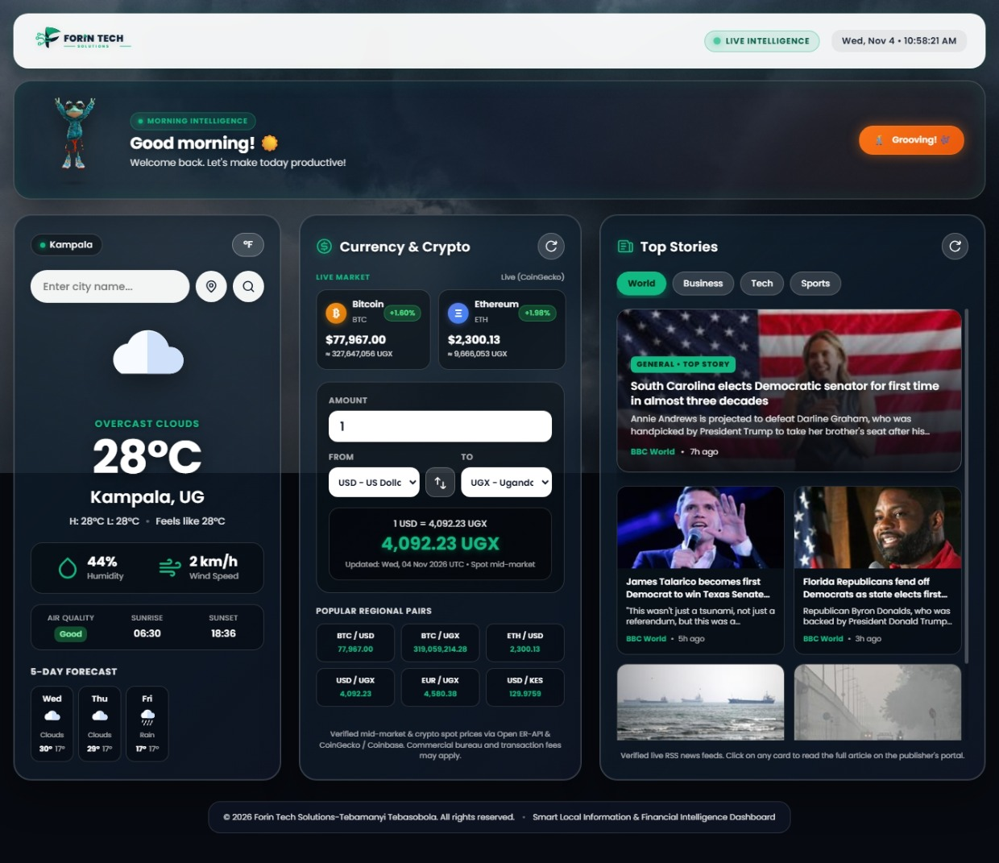

# Smart Local Information Dashboard

A responsive, high-performance web dashboard providing real-time local weather forecasts, live multi-fiat and cryptocurrency conversions, dynamic categorized news feeds, and interactive ambient UI elements.

Developed and maintained under the **Forin Tech Solutions** brand.

---

## Live Demo

Explore the live Smart Local Information Dashboard here: [View Live Application](https://smart-local-information-dashboard.vercel.app/).

---

## Project Preview

Below is a live capture of the single-page dashboard with the active grooving mascot animation, live cryptocurrency metrics, weather analytics for Kampala, and curated top news stories:




---

## Key Features

Based on the implemented codebase and live interface, the dashboard provides the following capabilities:

### 1. Live Weather & Atmospheric Intelligence
- **City Search & Geolocation Support:** Query atmospheric data for any global city or locate coordinates automatically using the browser's Geolocation API.
- **Real-Time Atmospheric Metrics:** Displays temperature, daily high/low limits, "feels like" metrics, relative humidity percentage, wind speed, sunrise time, and sunset time.
- **Air Quality Index (AQI):** Visual badge indicator (*Good*, *Fair*, *Moderate*, *Poor*, *Very Poor*) queried via the OpenWeather Air Pollution API.
- **5-Day Weather Forecast:** Daily forecasts showing condition iconography and temperature ranges.
- **Unit Toggle:** Instant switching between Metric (°C, km/h) and Imperial (°F, mph) standards.

### 2. Multi-Asset Currency & Cryptocurrency Converter
- **Live Crypto Showcase Cards:** Real-time ticker cards for Bitcoin (BTC) and Ethereum (ETH) with prices in USD and Ugandan Shillings (UGX), accompanied by 24-hour percentage change badges.
- **Universal Cross-Asset Converter:** Performs conversions bidirectionally across fiat currencies and cryptocurrencies (fiat-to-fiat, crypto-to-fiat, fiat-to-crypto, and crypto-to-crypto).
- **Supported Fiat Currencies:** USD, UGX, KES, TZS, EUR, GBP, RWF, ZAR, AED, CNY, and CAD.
- **Quick-Access Regional Pairs:** Pre-configured interactive tiles for popular regional pairings (BTC/USD, BTC/UGX, ETH/USD, USD/UGX, EUR/UGX, USD/KES).
- **Dual-Engine Redundancy:** Crypto rates sourced via CoinGecko Simple Price API with automated fallback to Coinbase Spot API; fiat rates powered by Open Exchange Rates API (`open.er-api.com`).

### 3. Categorized Global News Feed
- **Tabbed RSS Categories:** Switch seamlessly between **World**, **Business**, **Tech**, and **Sports** news feeds.
- **Multi-Tier Aggregator Pipeline:** Ingests live RSS feeds via `rss2json` with automated CORS proxy fallbacks and in-browser XML parsing.
- **Hero & Secondary Grid:** Top headlines display with high-visibility hero cards and background scrims, followed by responsive multi-column article grids.
- **Offline / Stale-Cache Mode:** Local caching (`localStorage`) allows stories to be viewed even during network interruptions.

### 4. Ambient User Experience & Interactive Mascot
- **Dynamic Photographic Backdrops:** Dual-layer background crossfades based on queried atmospheric conditions (Clear, Clouds, Rain, Drizzle, Thunderstorm, Snow, Mist/Fog, and Night).
- **Time-Aware Dynamic Greetings:** Automatically adjusts welcome headlines based on system time (Morning Intelligence, Midday Dispatch, Evening Intelligence, and After-Hours Monitor).
- **Client-Side Chroma-Keyed Mascot:** Transparent frog mascot rendered using an HTML5 Canvas chroma-key filter that strips solid backgrounds on the fly.
- **Interactive Dance Mode:** Clickable mascot stage with custom CSS keyframe animations, responsive floor shadows, context-aware speech bubbles, and a manual "Dance!" toggle button.
- **Synchronized Header Clock:** Real-time digital clock with an emerald "Live Intelligence" status badge.

---

## Technology Stack

| Layer | Technologies / Services |
| :--- | :--- |
| **Frontend Core** | HTML5, Modern CSS3 (Glassmorphism, CSS Grid, Flexbox, Keyframes), Vanilla JavaScript (ES6+, Async/Await) |
| **Canvas & Graphics** | HTML5 Canvas API (pixel manipulation & chroma keying), Inline SVG Graphics |
| **Weather & Air Quality** | [OpenWeatherMap API](https://openweathermap.org/) (Weather, 5-Day Forecast, Air Pollution) |
| **Fiat Exchange Rates** | [Open Exchange Rates API](https://open.er-api.com/) (`open.er-api.com/v6/latest/USD`) |
| **Cryptocurrency Data** | [CoinGecko Simple Price API](https://www.coingecko.com/en/api) & [Coinbase Spot Price API](https://docs.cdp.coinbase.com/) |
| **News Syndication** | Live RSS feeds (BBC, NY Times, Al Jazeera, NPR, TechCrunch, ESPN) resolved via `api.rss2json.com` and public CORS proxies |
| **Client Caching** | Browser `localStorage` API for offline resiliency and rate-limit prevention |
| **Typography** | [Google Fonts](https://fonts.google.com/) (*Poppins*) |

---

## Project Structure

```text
smart-local-information-dashboard/
|
├── index.html                   # Main dashboard page
├── styles.css                   # Glassmorphic layout, themes, and keyframe animations
├── script.js                    # Application controllers, state, and API pipelines
├── images/                      # Weather icons, mascot, and UI assets
│   ├── clouds.svg
│   ├── clear-sun.svg
│   ├── drizzle.svg
│   ├── frog.png
│   ├── humidity.svg
│   ├── mist.svg
│   ├── rain.svg
│   ├── search icon.jpg
│   ├── snow.svg
│   └── wind.svg
├── screenshots/                 # Project preview images
│   └── dashboard-preview.png
└── README.md                    # Project documentation
```